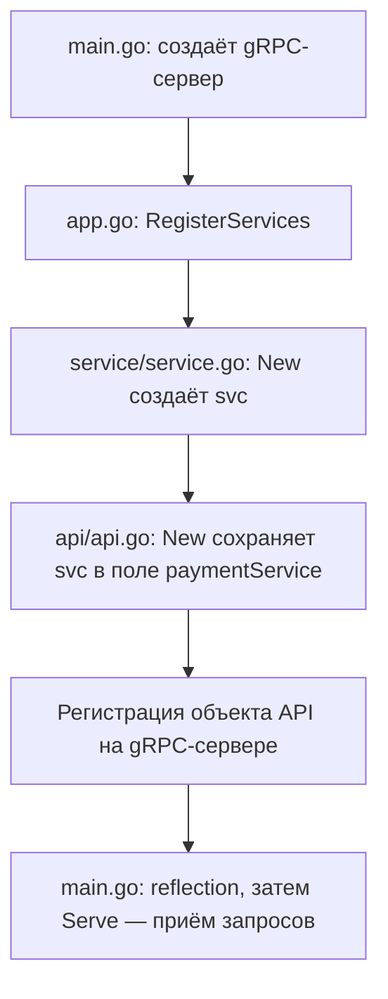
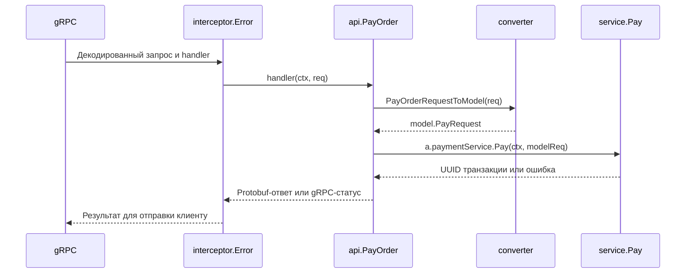

# Payment: короткая карта файлов и вызовов

Этап Payment завершён: слои подключены, 8 сценариев сервиса и 4 сценария API
прошли с `-race` по результатам запуска 9 октября 2026.
Payment имитирует оплату: проверяет запрос и возвращает новый UUID транзакции.
Базы данных и реального списания денег здесь нет.

## 1. При запуске создаём и соединяем объекты

[cmd/main.go](cmd/main.go) открывает порт `:50052`, получает настройки из
`app.Interceptors()`, добавляет keepalive и создаёт gRPC-сервер.
Затем вызывает `app.RegisterServices(grpcServer)` из [pkg/app/app.go](pkg/app/app.go):

```go
svc := payment.New()
api := paymentAPI.New(svc)
paymentv1.RegisterPaymentServiceServer(grpcServer, api)
```



Сервис и API создаются при запуске. Их методы вызываются позже, при запросах.
При сигнале остановки `main` вызывает `GracefulStop`.

## 2. Как связаны файлы

Go импортирует **пакет (каталог)**. Файлы одного пакета видят объявленные в нём типы.
Метод связан с типом через получатель — запись в скобках после `func`:

```text
internal/api/payment/v1/                 один пакет v1
  api.go:  type api struct { ... }
  pay.go:  func (a *api) PayOrder(...)    метод типа *api

internal/service/payment/                один пакет payment
  service.go: type service struct{}
  pay.go:     func (s *service) Pay(...)  метод типа *service
```

- [service.go](internal/service/payment/service.go) создаёт `*service`, который умеет
  вызывать [Pay](internal/service/payment/pay.go).
- [api.go](internal/api/payment/v1/api.go) создаёт `*api` и сохраняет сервис в поле
  `paymentService`. Тип поля — [интерфейс PaymentService из deps.go](internal/api/payment/v1/deps.go).
- [API pay.go](internal/api/payment/v1/pay.go) обращается к этому полю:
  `a.paymentService.Pay(...)`. Здесь `a` — тот объект API, на котором вызвали `PayOrder`.

**Связь API с конкретным сервисом создаёт `app.go`, передавая `svc` в конструктор.**
Сам API знает только интерфейс с методом `Pay`, поэтому в тестах принимает и мок.

## 3. При запросе вызываем методы

Клиент, например Order, отправляет `order_uuid` и `payment_method` по
[контракту payment.proto](../shared/proto/payment/v1/payment.proto).
gRPC декодирует запрос. В [payment_grpc.pb.go](../shared/pkg/proto/payment/v1/payment_grpc.pb.go)
сгенерированный обработчик вызывает зарегистрированный API через интерсептор.



| Где | Что происходит |
|---|---|
| [interceptor/error.go](internal/interceptor/error.go) | Вызывает `handler(ctx, req)`, продолжая обработку |
| [API pay.go](internal/api/payment/v1/pay.go) | Получает `*paymentv1.PayOrderRequest`, вызывает конвертер |
| [converter/payment.go](internal/converter/payment.go) | Создаёт `model.PayRequest`, переводит proto-enum в доменный тип |
| [model/payment.go](internal/model/payment.go) | Объявляет структуру запроса и `PaymentMethod.IsValid()` |
| [Service pay.go](internal/service/payment/pay.go) | Проверяет UUID и способ оплаты, создаёт UUID транзакции, пишет лог |
| [API pay.go](internal/api/payment/v1/pay.go) | Помещает UUID в `PayOrderResponse` либо преобразует ошибку |
| [interceptor/error.go](internal/interceptor/error.go) | Сохраняет готовый результат; обычную необработанную ошибку переводит в `Internal` |

**Модель — данные, а не вызывающий слой.** Конвертер возвращает структуру в API,
и API передаёт её сервису. Между этими компонентами нет сети — это Go-вызовы.

При успехе gRPC отправляет protobuf-ответ клиенту. Если клиент — Order, он сохраняет
UUID транзакции и статус `PAID` в своём заказе. Сам Payment состояние заказа не хранит.

## 4. Как возвращается ошибка

```text
Service: UUID не разбирается
  → errs.ErrInvalidOrderUUID
  → API: errors.Is распознаёт ошибку, возвращает InvalidArgument
  → интерсептор сохраняет готовый gRPC-статус
  → клиент получает ошибку
```

[Доменные ошибки](internal/errors/errors.go) описывают причину отказа.
API переводит обе ошибки валидации в `InvalidArgument`.
Для неизвестной ошибки API пишет подробности в лог, клиент получает
`Internal` и «внутренняя ошибка».

## 5. Где находятся тесты

```text
Тест сервиса → настоящий service.Pay → UUID / доменная ошибка
Тест API     → настоящий api.PayOrder → мок PaymentService → заданный результат
```

- [Тесты сервиса](internal/service/payment/tests/pay_test.go): 8 сценариев —
  допустимые способы оплаты и ошибки входных данных.
- [Тесты API](internal/api/payment/v1/tests/pay_test.go): 4 сценария —
  ответ с UUID, две доменные ошибки и неизвестная ошибка.
- [Мок](internal/api/payment/v1/mocks/mock_payment_service.go) сгенерирован mockery
  по `deps.go`. Тест задаёт ожидаемые аргументы и результат через `EXPECT().Pay(...).Return(...).Once()`.

Unit-тесты вызывают методы напрямую, без сети и интерсептора.
В работающем приложении `app.go` подключает настоящий сервис, а не мок.

Следующий шаг — **2.1: модели Inventory**. Общий прогресс и задания находятся в
[WEEK_2_GUIDE.md](../WEEK_2_GUIDE.md).
